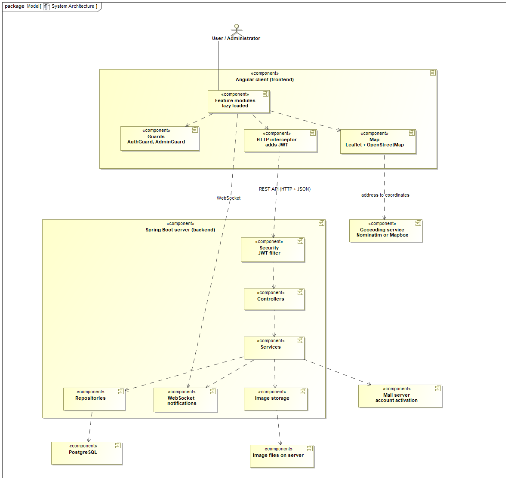
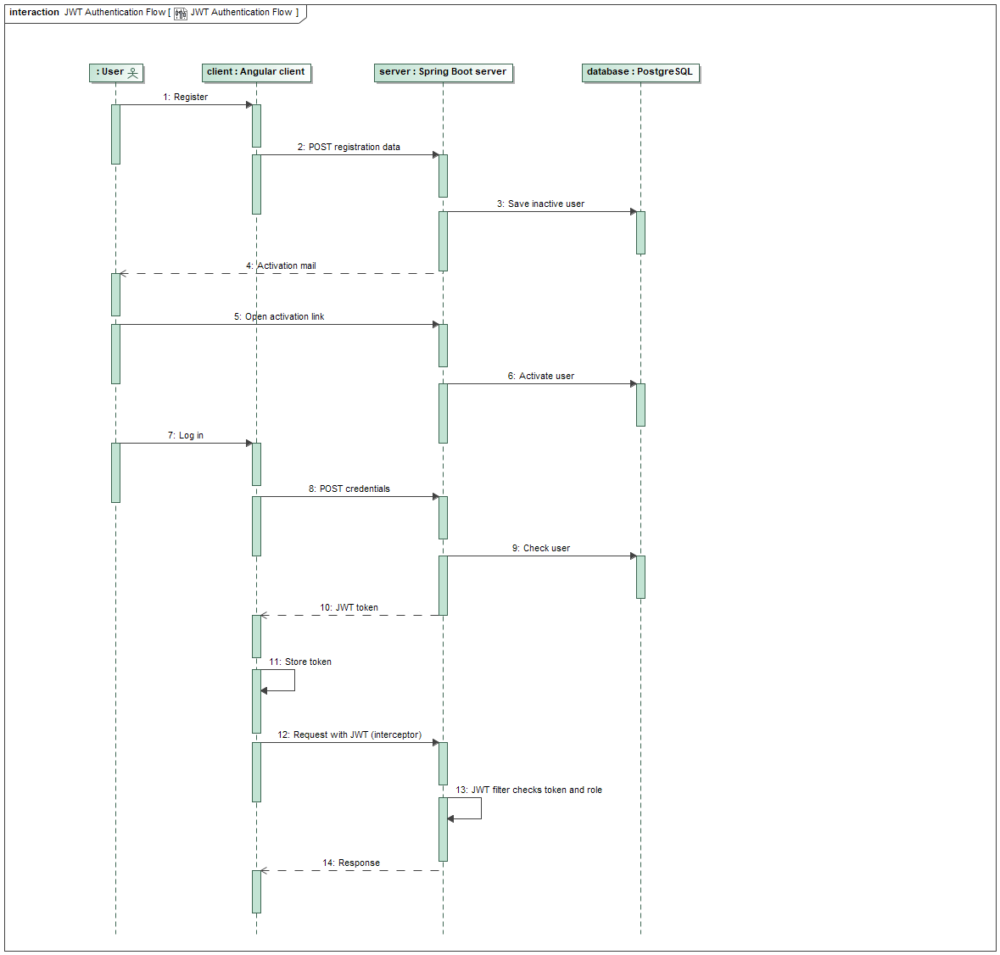

# System Architecture

This document describes how the Recipes application is built and which technical decisions the team made in Sprint 1. It is the reference for all three members, so everyone builds the system the same way.

## 1. Overview

The system has three parts: an Angular client, a Spring Boot server and a PostgreSQL database. The client talks to the server over a REST API (JSON) and over a WebSocket connection for notifications. Uploaded images are stored on the server. The diagrams were drawn in MagicDraw.



## 2. Client (frontend)

- Angular (TypeScript, HTML, CSS) with Angular Material as the UI library.
- The application is split into feature modules, each loaded lazily through its own route: `auth`, `profile`, `recipes`, `search`, `ingredients and shopping lists`, `map`, `notifications` and `admin`. A `shared` module holds common components, and the theme (colors and fonts) is defined once.
- `AuthGuard` protects pages for logged-in users and `AdminGuard` protects the administrator area.
- An HTTP interceptor adds the JWT token to every request to the server.
- Models are TypeScript interfaces in a common folder (at least user, recipe, ingredient and allergen).
- Services return mock data at first, so the first checkpoint can be shown without the server. They are replaced by real HTTP calls without changing the components.
- Every component has its own CSS file.

## 3. Server (backend)

Spring Boot (Java 21), built with Maven. Packages:

| Package | Responsibility |
| --- | --- |
| `controller` | REST endpoints, request and response handling |
| `service` | business logic |
| `repository` | database access |
| `model` | database entities |
| `dto` | objects sent to and received from the client |
| `config` | configuration (CORS, WebSocket, database) |
| `security` | JWT authentication and authorization |

- Errors are returned as an HTTP status code with a message.
- Input is validated on the server, as well as on the client.
- The database password is read from environment variables and is never stored in the repository.

## 4. Database

PostgreSQL. The server connects to it through the `repository` layer. The data model follows the entities from the specification (user, recipe, ingredient, allergen, shopping list, notification and others).

## 5. Authentication (JWT)



- Roles: user and administrator.
- The client uses the guards to hide pages, and the server checks the token and the role on every protected endpoint.

## 6. Notifications (WebSocket)

The server pushes notifications to logged-in users over a WebSocket connection. The client shows them in the notifications module without refreshing the page.

## 7. Images

Images uploaded by users are stored on the server. The database keeps only the path or file name. The client uploads images with drag and drop and receives the image address from the server.

## 8. Map and location

The map is shown with Leaflet and OpenStreetMap. Addresses are converted to coordinates (geocoding) with a public service (Nominatim or Mapbox).

## 9. Repository structure

```
frontend/   Angular client
backend/    Spring Boot server
docs/       documentation and diagrams
```

One repository is used for all three parts. Branches, commit messages and pull requests are described in the main `README.md`.

## 10. Decisions

| Question | Decision | Date |
| --- | --- | --- |
| UI library | Angular Material | 17 Nov 2026 |
| Server build tool | Maven | 17 Nov 2026 |
| Java version | 21 | 17 Nov 2026 |
| Node version | 22.12 or newer | 17 Nov 2026 |
| Repository | one repository with `frontend`, `backend` and `docs` | 17 Nov 2026 |
| Database | PostgreSQL | specification |
| Language of commits, pull requests and README | English | 17 Nov 2026 |

## 11. Open questions

These are not decided yet and will be agreed on before the related cards start:

- Where exactly the images are stored on the server (folder name and size limit).
- Which geocoding service is used (Nominatim or Mapbox).
- Which mail server or service sends the activation mail.
